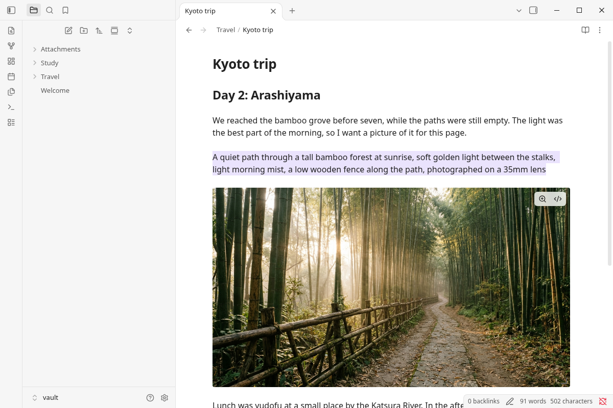
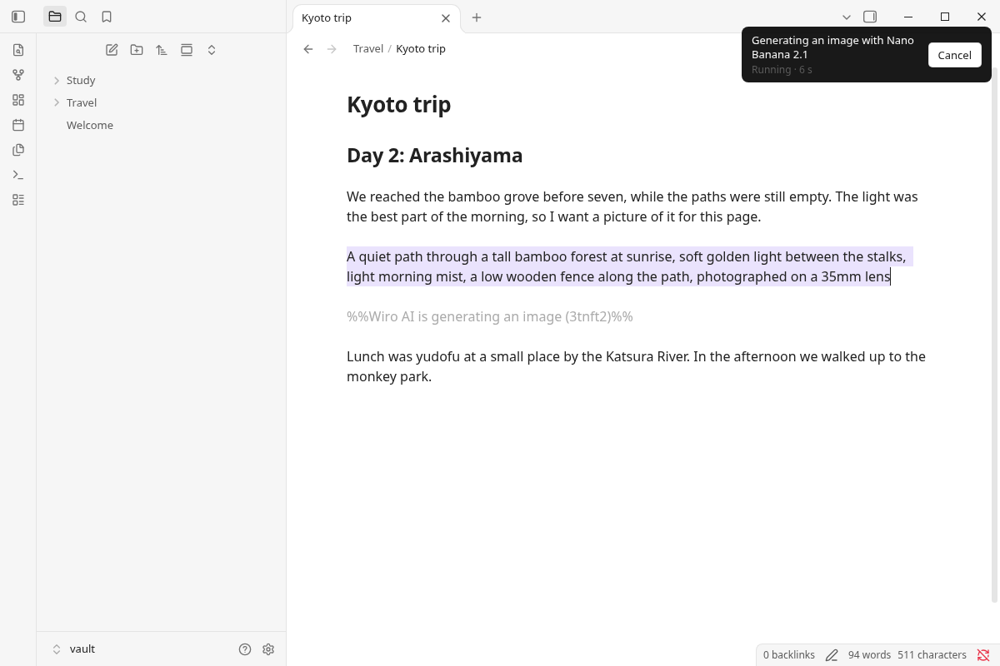
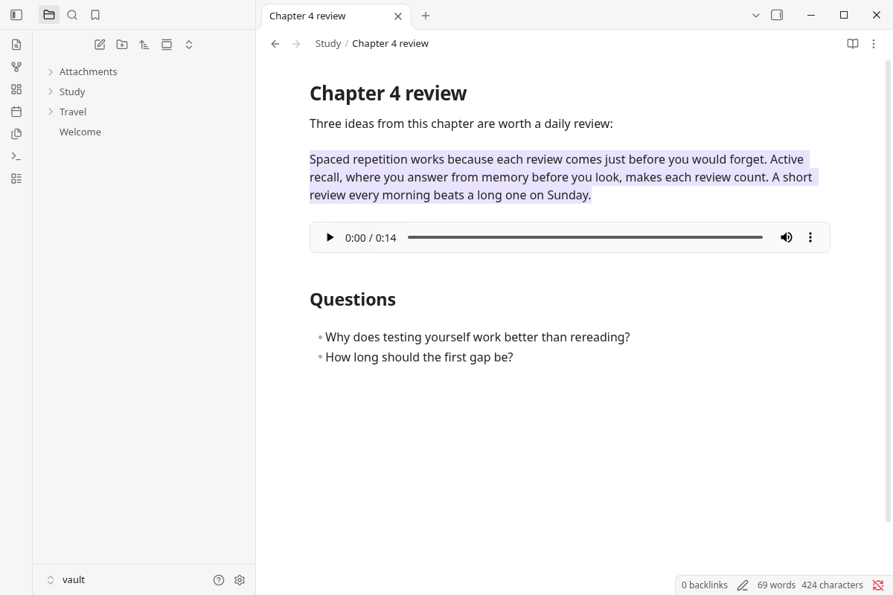
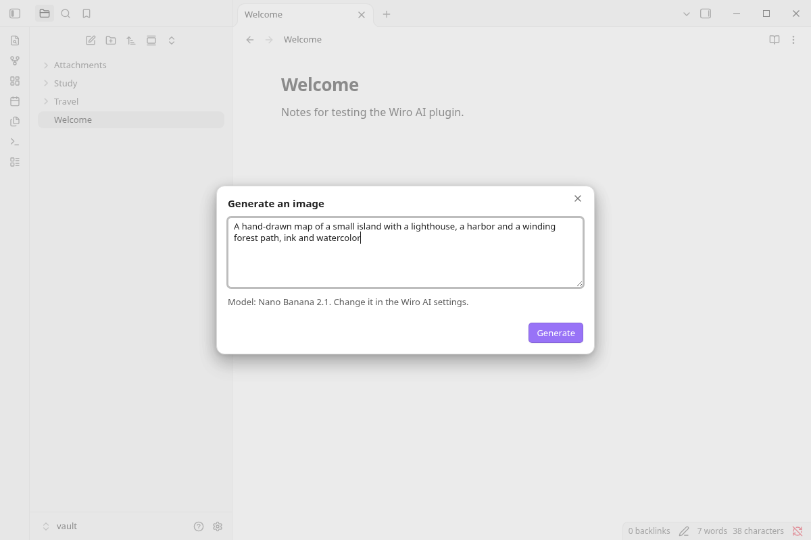

<div align="center">


# Wiro AI for Obsidian

Generate images from a prompt or the selected text, and turn the selection into speech, with models from the Wiro AI catalog of 1,000+ models. The files land in your vault and are embedded in the note.

[](https://obsidian.md) [](https://github.com/wiroai/Wiro-Obsidian/actions/workflows/ci.yml) [](./LICENSE)

[Website](https://wiro.ai) · [Models](https://wiro.ai/models) · [Docs](https://wiro.ai/docs) · [Dashboard](https://wiro.ai/panel)

</div>

Select a paragraph that describes a picture and run **Generate image from selection**: the plugin sends the text to an image model on [Wiro AI](https://wiro.ai), saves the result in your attachments folder and embeds it under the paragraph. **Generate speech from selection** does the same with a text-to-speech model and an audio file, so a note can carry its own narration. You pick the models and their options (aspect ratio, resolution, voice, language) in the settings.



## Commands

| Command | What it does |
| --- | --- |
| **Generate image** | Opens a prompt box, filled with the selection if there is one, and embeds the image after the current line |
| **Generate image from selection** | Uses the selected text as the prompt and embeds the image under it |
| **Generate speech** | Opens a text box and embeds the audio file after the current line |
| **Generate speech from selection** | Reads the selected text aloud into an audio file and embeds it under the text |

Right-click a selection for **Generate image with Wiro AI** and **Generate speech with Wiro AI**. Every command can get a hotkey in **Settings → Hotkeys**.

While a task runs, a notice shows its progress and a **Cancel** button, and a comment in the note marks where the result will go. When the task ends, the comment becomes the embed. Cancel stops the task on Wiro AI and removes the comment.








## Install

**From Obsidian:** open **Settings → Community plugins**, select **Browse**, search for **Wiro AI**, then select **Install** and **Enable**.

**Manually:** download `main.js`, `manifest.json` and `styles.css` from the [latest release](https://github.com/wiroai/Wiro-Obsidian/releases/latest) into `<your vault>/.obsidian/plugins/wiro-ai/`, then enable **Wiro AI** under **Settings → Community plugins**.

The plugin uses only APIs that Obsidian offers on both desktop and mobile, and needs Obsidian 1.13.2 or later.

## Set your API key

1. Sign up at [wiro.ai](https://wiro.ai) and create a project at [wiro.ai/panel/project/new](https://wiro.ai/panel/project/new). The **API Key Only** authentication type is the simplest. For a **Signature-based** project you need the API secret as well.
2. In Obsidian, open **Settings → Wiro AI**. Next to **API key**, select **Link...**, give the secret an ID such as `wiro-api-key`, paste the key and select **Save**. For a signature-based project, do the same for **API secret**.
3. Select **Check** to make sure Wiro AI accepts the key. The check is free.

Obsidian keeps the key in its keychain (**Settings → Keychain**), outside the vault. The plugin's `data.json` stores only the ID of the secret.


## Models

The settings list these models. Each one shows its own options, with the defaults from its page on wiro.ai.

| Images | Speech |
| --- | --- |
| [Nano Banana 2.1](https://wiro.ai/models/google/nano-banana-2-1) (default) | [Eleven v4](https://wiro.ai/models/elevenlabs/eleven-v4) (default) |
| [Nano Banana Pro](https://wiro.ai/models/google/nano-banana-pro) | [Eleven v4 Turbo](https://wiro.ai/models/elevenlabs/eleven-v4-turbo) |
| [GPT Image 2](https://wiro.ai/models/openai/gpt-image-2) | [Gemini 3.1 Flash TTS](https://wiro.ai/models/google/gemini-3-1-tts) |
| [Seedream 5 Pro](https://wiro.ai/models/bytedance/seedream-v5-pro) | [Gemini 2.5 TTS](https://wiro.ai/models/google/gemini-2-5-tts) |
| [FLUX.2 Pro](https://wiro.ai/models/black-forest-labs/flux-2-pro) | [MiMo 2.5 TTS](https://wiro.ai/models/xiaomimimo/mimo-2-5-tts) |
| [FLUX.2 Dev](https://wiro.ai/models/wiro/flux-2-dev) | |
| [Grok Imagine Image](https://wiro.ai/models/xai/grok-imagine-image) | |
| [Qwen Image 3.0](https://wiro.ai/models/alibaba/qwen-image-3-0) | |
| [P-Image](https://wiro.ai/models/pruna/p-image) | |

To use another model, pick **Other model** and type its ID, the end of its page URL: `google/nano-banana-pro` for `https://wiro.ai/models/google/nano-banana-pro`. The plugin loads that model's options from the public catalog.

## Settings

| Setting | What it does |
| --- | --- |
| **API key**, **API secret** | Links the key, and the secret for signature-based projects, from Obsidian's keychain |
| **Model** | The image or speech model. **Other model** takes any model ID from [wiro.ai/models](https://wiro.ai/models) |
| Model options | One dropdown per option of the chosen model, such as **Aspect ratio**, **Resolution**, **Voice** or **Language** |
| **Extra parameters** | A JSON object sent with every run, for parameters without a dropdown, such as `{"seed": 42}` |
| **Folder** | Where new files go. Empty means the attachment folder from **Settings → Files and links** |
| **Read Markdown as plain text** | For speech: reads link text instead of URLs and skips formatting marks, embeds and code. On by default |

Files are named like Obsidian's pasted images, `Wiro image 20261111153012.png` and `Wiro speech 20261111153012.mp3`, and the embed follows your link format (wikilinks or Markdown links).

## Network use and privacy

Running a model needs a Wiro AI account and an API key, and each run is charged to that account (see [Pricing](#pricing)). The plugin talks to Wiro AI only, and only when you run a command or open its settings:

- **`api.wiro.ai`**: a command sends the prompt or the selected text, with the model options, to the [Run API](https://wiro.ai/docs/run-a-model), then reads the task status until it ends. **Cancel** stops the task, and **Check** makes one request that confirms the key. These requests carry your API key, plus a signature for signature-based projects.
- **`api.wiro.ai/v1/Tool/Detail`**: reads the parameters of the chosen model from the public catalog, without your key, when a run starts and when the settings show a model that is not in the built-in list.
- **`cdn1.wiro.ai`**: the result files are downloaded from Wiro AI's file host and saved in your vault. The plugin downloads files from `wiro.ai` hosts only.

Only the text you select or type is sent. The rest of the note and the vault stay on your device. The plugin has no telemetry or analytics and makes no requests in the background. See Wiro AI's [privacy policy](https://wiro.ai/agreement/privacy-policy) and [terms of service](https://wiro.ai/agreement/terms-of-service).

## How it works

- Requests go through Obsidian's `requestUrl`, which works on desktop and mobile.
- A run is a `POST /Run/{owner}/{model}` request. The plugin polls `Task/Detail` every few seconds until the task reaches `task_postprocess_end`, checks that `pexit` is `"0"` and saves the output files ([Tasks](https://wiro.ai/docs/tasks)).
- Required settings you don't set get the defaults from the model's page, so a text-to-image or text-to-speech model needs only the prompt.
- A run gives up after 15 minutes and stops the task.
- The key is read from Obsidian's keychain at run time and is never written to the vault.

## Development

```bash
npm install
npm run dev     # rebuilds main.js on every change
npm run lint    # ESLint with eslint-plugin-obsidianmd, the rules Obsidian's plugin review runs
npm test        # unit tests, no network
npm run build   # type check and production build
```

To try a build, copy `main.js`, `manifest.json` and `styles.css` into `<vault>/.obsidian/plugins/wiro-ai/` and reload Obsidian. `npm run models` refreshes the built-in model list in `src/models.json` from the public Wiro AI catalog.

Releases come from tags: `npm version 1.0.1` updates `manifest.json` and `versions.json`, and pushing the `1.0.1` tag runs the release workflow, which builds the plugin, attests `main.js`, `manifest.json` and `styles.css`, and drafts a GitHub release with them. See [CONTRIBUTING.md](./CONTRIBUTING.md).

## Pricing

Each run is charged to your Wiro AI account at the model's price, listed on its model page. Nano Banana 2.1 costs $0.0336 per image at 1K, and Eleven v4 costs $0.08 per 1,000 characters. The notice at the end of a run shows what it cost, and [wiro.ai/panel](https://wiro.ai/panel) has your balance and history.

## More from Wiro AI

| Repository | What it is |
| --- | --- |
| [Wiro-MCP](https://github.com/wiroai/Wiro-MCP) | Official MCP server for Wiro AI, [`@wiro-ai/wiro-mcp` on npm](https://www.npmjs.com/package/@wiro-ai/wiro-mcp) |
| [Wiro-Plugin](https://github.com/wiroai/Wiro-Plugin) | Wiro AI plugin for Cursor, Claude Code, Gemini CLI and Devin |
| [Wiro-LLM](https://github.com/wiroai/Wiro-LLM) | Wiro AI provider for the Vercel AI SDK and LLM gateway examples, [`@wiro-ai/wiro-llm` on npm](https://www.npmjs.com/package/@wiro-ai/wiro-llm) |
| [Wiro-Obsidian](https://github.com/wiroai/Wiro-Obsidian) | Wiro AI plugin for Obsidian (this repository) |
| [Wiro-ComfyUI](https://github.com/wiroai/Wiro-ComfyUI) | Wiro AI nodes for ComfyUI |
| [Wiro-Dify-Plugin](https://github.com/wiroai/Wiro-Dify-Plugin) | Wiro AI plugins for Dify: the LLM gateway as a model provider, plus image, video, speech and music tools |
| [Wiro-Raycast](https://github.com/wiroai/Wiro-Raycast) | Wiro AI extension for Raycast |
| [Wiro-WordPress](https://github.com/wiroai/Wiro-WordPress) | Wiro AI plugin for WordPress |
| [Wiro-Blender](https://github.com/wiroai/Wiro-Blender) | Wiro AI add-on for Blender |
| [Wiro-Next-Starter](https://github.com/wiroai/Wiro-Next-Starter) | Next.js starter for Wiro AI |
| [Wiro-Zed](https://github.com/wiroai/Wiro-Zed) | Wiro AI MCP server for the Zed editor |
| [Wiro-Action](https://github.com/wiroai/Wiro-Action) | GitHub Action for Wiro AI |
| [Wiro-Hermes](https://github.com/wiroai/Wiro-Hermes) | Wiro AI as a model provider for Hermes Agent |
| [n8n-nodes-wiroai](https://github.com/wiroai/n8n-nodes-wiroai) | Wiro AI nodes for n8n, [`@wiro-ai/n8n-nodes-wiroai` on npm](https://www.npmjs.com/package/@wiro-ai/n8n-nodes-wiroai) |
| [Wiro-Chromium-Extension](https://github.com/wiroai/Wiro-Chromium-Extension) | Wiro AI extension for Chrome, Edge, Opera and Brave |
| [Wiro-Firefox-Extension](https://github.com/wiroai/Wiro-Firefox-Extension) | Wiro AI add-on for Firefox |
| [Wiro-Safari-Extension](https://github.com/wiroai/Wiro-Safari-Extension) | Wiro AI extension for Safari on the Mac |
| [Swift-QuickStart](https://github.com/wiroai/Swift-QuickStart) | WiroKit, the Wiro AI SDK for iOS |
| [Kotlin-QuickStart](https://github.com/wiroai/Kotlin-QuickStart) | WiroKit, the Wiro AI SDK for Android |
| [Dart-QuickStart](https://github.com/wiroai/Dart-QuickStart) | Wiro AI SDK for Dart and Flutter, [`wiro` on pub.dev](https://pub.dev/packages/wiro) |
| [ReactNative-QuickStart](https://github.com/wiroai/ReactNative-QuickStart) | Wiro AI SDK for React Native and Expo, [`@wiro-ai/wiro-react-native` on npm](https://www.npmjs.com/package/@wiro-ai/wiro-react-native) |
| [Swift-Realtime](https://github.com/wiroai/Swift-Realtime) | Realtime voice AI example for iOS |
| [Kotlin-Realtime](https://github.com/wiroai/Kotlin-Realtime) | Realtime voice AI example for Android |
| [Dart-Realtime](https://github.com/wiroai/Dart-Realtime) | Realtime voice AI example for Flutter |
| [ReactNative-Realtime](https://github.com/wiroai/ReactNative-Realtime) | Realtime voice AI example for React Native |
| [Wiro-Docs](https://github.com/wiroai/Wiro-Docs) | Source of the Wiro AI API docs |

[Website](https://wiro.ai) · [Models](https://wiro.ai/models) · [Docs](https://wiro.ai/docs) · [X](https://x.com/wiroai)

## License

MIT, see [LICENSE](./LICENSE).
