<div align="center">


# Wiro AI for Obsidian

Generate, edit and upscale images, make videos, speech and music, transcribe voice notes, and summarize, rewrite, translate or continue your writing, with models from the Wiro AI catalog of 1,000+ models. Every result is saved in your vault and placed in the note.

[](https://obsidian.md) [](https://github.com/wiroai/Wiro-Obsidian/actions/workflows/ci.yml) [](./LICENSE)

[Website](https://wiro.ai) · [Models](https://wiro.ai/models) · [Docs](https://wiro.ai/docs) · [Dashboard](https://wiro.ai/panel)

</div>

Select a paragraph and turn it into an image, a narration or a short video. Edit or upscale an image that is already in the note, put the transcript of a voice memo under its audio file, or ask an LLM to summarize, rewrite, translate or continue your text. Anything else in the [Wiro AI catalog](https://wiro.ai/models), and the workflows in your Wiro AI project, run from a form inside Obsidian. Each dialog shows the price before anything runs, and the history panel keeps track of what each run made and cost.

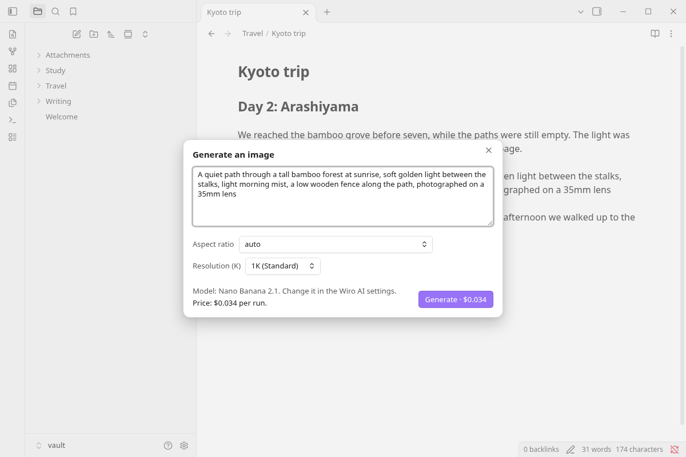

## What you can do

### Images

**Generate image** turns a prompt, or the selected text, into an image and embeds it after the current line. **Edit image** takes an image that is already in the note, shows it above a text box for your instruction, and saves the edited copy under the original: "make it a watercolor painting", "remove the people in the background". **Upscale image** saves a larger, sharper copy the same way. The image on the cursor line is used; with several images in the note, you pick one from a list.

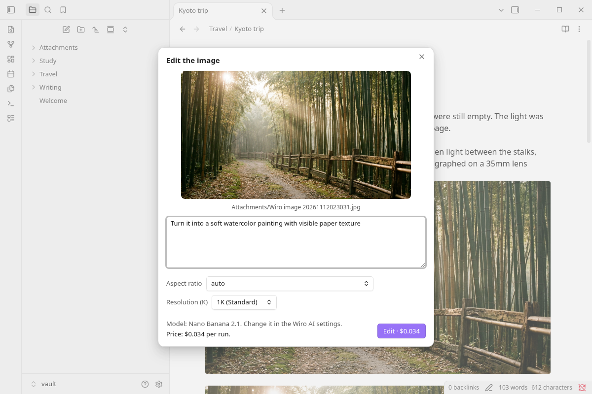

### Video

**Generate video** turns a description of the scene, the motion and the camera into an MP4 file, embedded in the note so it plays in place. The dialog has the duration, aspect ratio and resolution of the chosen model.

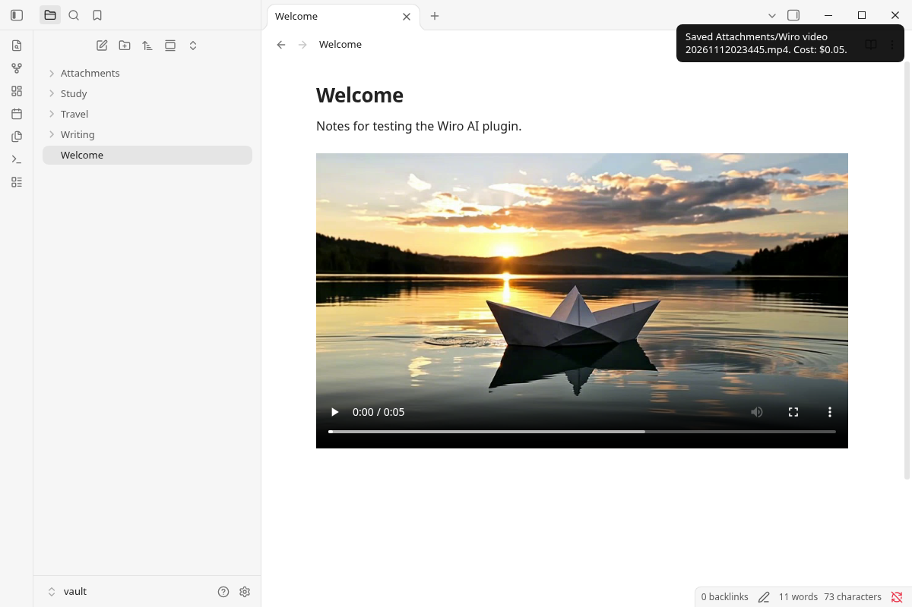

### Speech, music and transcription

**Generate speech** reads the selection or any text aloud into an audio file, with the voice and language pickers of the model. **Read note aloud** does it for the whole note and puts the player at the top. By default, Markdown is read as plain text: link text instead of URLs, without formatting marks, embeds or code.

**Transcribe audio** writes down what is said in an audio file of the note, such as a voice memo from Obsidian's audio recorder, and puts the transcript under it as a callout, a quote or a plain paragraph. **Generate music** makes a track from a description of the genre, instruments, mood and tempo.

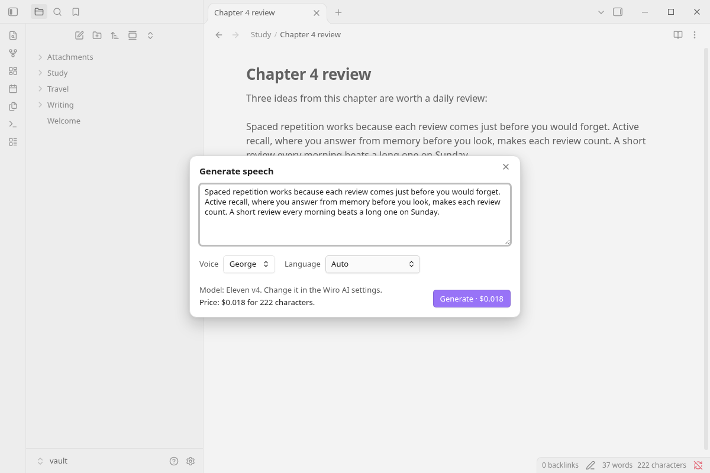

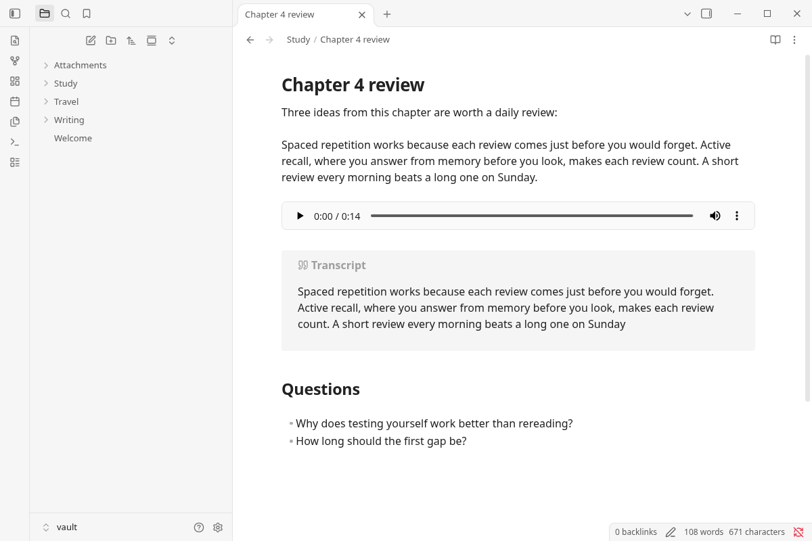

### Writing

**Summarize note or selection**, **Rewrite selection**, **Translate selection**, **Continue writing** and **Ask about this note** send text to a model on the Wiro AI LLM gateway. The answer appears in a window as the model writes it (on mobile, when it is complete), and you choose what happens to it: **Replace the selection**, **Insert below** or **Insert at the cursor**. **Stop** ends it early. Pick the model under **Settings → Wiro AI → Text**; the list shows each model's price per million input and output tokens.

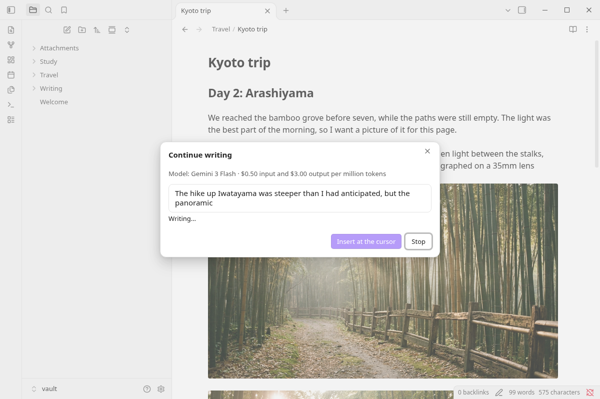

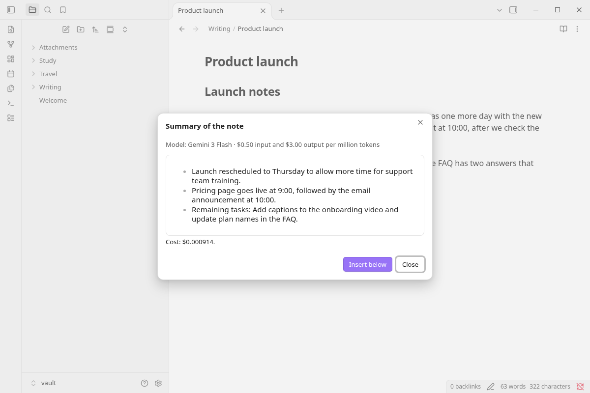

### Any model, any workflow

**Run a model** opens the catalog by kind (text to image, image to video, talking head, voice cloning, 3D generation and more), with a search box and the price of each model. Pick one and the plugin builds a form from the model's own inputs: text fields, dropdowns, numbers, switches and file fields that take a file from your vault or a URL. The selected text fills the prompt. Images, videos and audio files are saved and embedded; text answers go into the note.

**Run a workflow** lists the workflows of your Wiro AI project, or takes a link from [wiro.ai/workflows](https://wiro.ai/workflows), and shows a form for the workflow's inputs. While it runs, the notice shows the step it is on, and the outputs go into the note under their names.

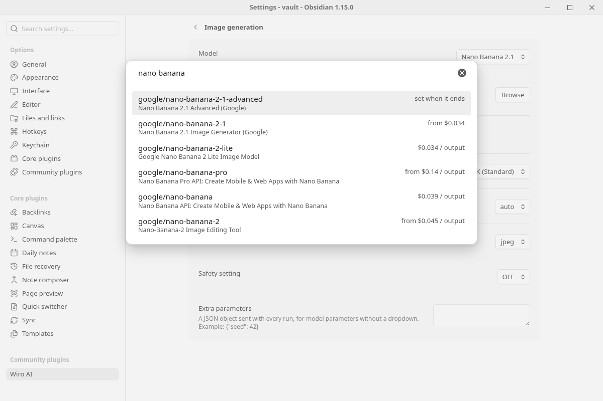

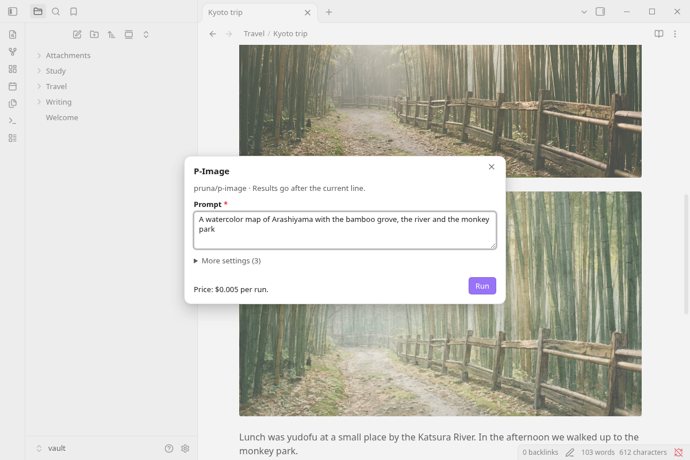

### Price first, history after

Every dialog and form shows the price for the current options in one line, such as `$0.034 per run` or `$0.018 for 222 characters`, and the run dialogs repeat it on the button. The notice at the end of a run shows what it cost. **Open history** shows the runs from this vault, newest first, with the model, the cost, the saved files and the note, plus the latest tasks on your Wiro AI account.

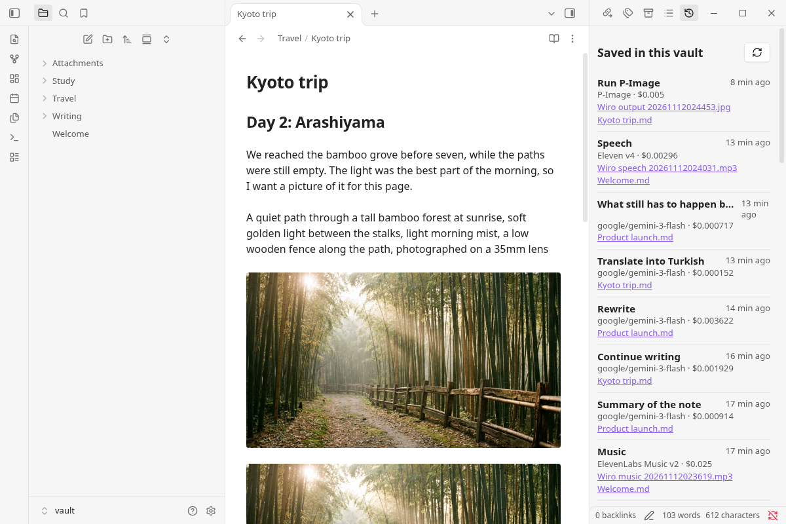

## Commands

| Command | What it does |
| --- | --- |
| **Generate image** | Opens the image dialog, with the selection as the prompt if there is one, and embeds the image after the current line |
| **Generate image from selection** | Uses the selected text as the prompt and embeds the image under it |
| **Edit image** | Edits an embedded image from a text instruction and embeds the result under it |
| **Upscale image** | Embeds a larger copy of an embedded image under it |
| **Generate video** | Generates a video from a prompt and embeds the MP4 file |
| **Generate speech** | Reads a text aloud into an audio file, embedded after the current line |
| **Generate speech from selection** | Reads the selected text aloud and embeds the audio under it |
| **Read note aloud** | Reads the whole note aloud and puts the audio at the top |
| **Transcribe audio** | Puts the transcript of an embedded audio file under it |
| **Generate music** | Makes a music track from a description |
| **Summarize note or selection** | Summarizes the selection, or the note when nothing is selected, in a few bullet points |
| **Rewrite selection** | Rewrites the selected text so it reads more clearly, keeping its meaning, language and tone |
| **Translate selection** | Translates the selection into the language you pick |
| **Continue writing** | Writes one or two paragraphs that carry on from the cursor |
| **Ask about this note** | Answers a question about the note |
| **Run a model** | Runs any model from the catalog through a form built from its inputs |
| **Run a workflow** | Runs one of your Wiro AI workflows through a form |
| **Open history** | Opens the history panel in the right sidebar |

Right-click a selection for **Generate image**, **Generate speech**, **Summarize**, **Rewrite** and **Translate** with Wiro AI. Every command can get a hotkey in **Settings → Hotkeys**.

While an image, video, audio, model or workflow run is in progress, a notice shows its progress and a **Cancel** button, and a comment in the note marks where the result will go. When the run ends, the comment becomes the embed. Cancel stops the task on Wiro AI and removes the comment.

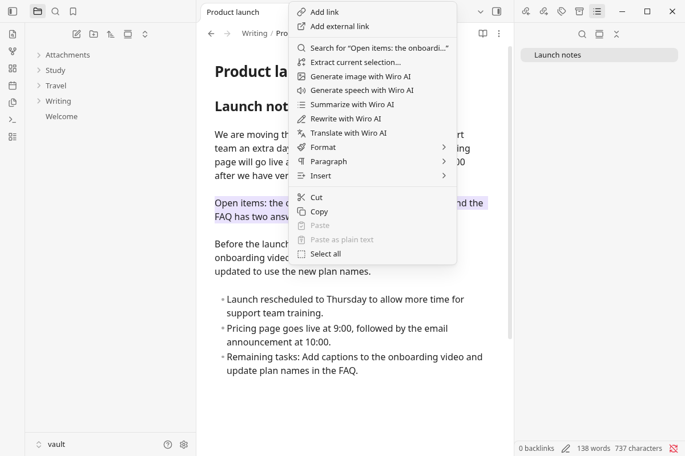

## Install

**From Obsidian:** open **Settings → Community plugins**, select **Browse**, search for **Wiro AI**, then select **Install** and **Enable**.

**Manually:** download `main.js`, `manifest.json` and `styles.css` from the [latest release](https://github.com/wiroai/Wiro-Obsidian/releases/latest) into `<your vault>/.obsidian/plugins/wiro-ai/`, then enable **Wiro AI** under **Settings → Community plugins**.

The plugin works on desktop and mobile and needs Obsidian 1.13.2 or later.

## Set your API key

1. Sign up at [wiro.ai](https://wiro.ai) and create a project at [wiro.ai/panel/project/new](https://wiro.ai/panel/project/new). The **API Key Only** authentication type is the simplest. For a **Signature-based** project you need the API secret as well.
2. In Obsidian, open **Settings → Wiro AI**. Next to **API key**, select **Link...**, give the secret an ID such as `wiro-api-key`, paste the key and select **Save**. For a signature-based project, do the same for **API secret**.
3. Select **Check** to make sure Wiro AI accepts the key. The check is free.

Obsidian keeps the key in its keychain (**Settings → Keychain**), outside the vault. The plugin's `data.json` stores only the ID of the secret.

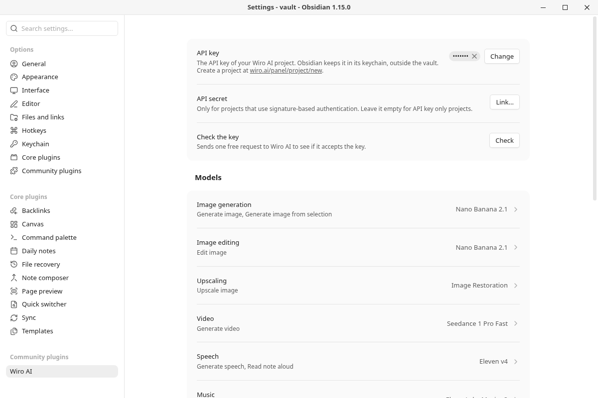

## Models

Each kind of model has its own page in the settings, with a list to start from. The first model is the default.

| Kind | Models in the list |
| --- | --- |
| Image generation | [Nano Banana 2.1](https://wiro.ai/models/google/nano-banana-2-1), [Nano Banana Pro](https://wiro.ai/models/google/nano-banana-pro), [GPT Image 2](https://wiro.ai/models/openai/gpt-image-2), [Seedream 5 Pro](https://wiro.ai/models/bytedance/seedream-v5-pro), [FLUX.2 Pro](https://wiro.ai/models/black-forest-labs/flux-2-pro), [FLUX.2 Dev](https://wiro.ai/models/wiro/flux-2-dev), [Grok Imagine Image](https://wiro.ai/models/xai/grok-imagine-image), [Qwen Image 3.0](https://wiro.ai/models/alibaba/qwen-image-3-0), [P-Image](https://wiro.ai/models/pruna/p-image) |
| Image editing | [Nano Banana 2.1](https://wiro.ai/models/google/nano-banana-2-1), [GPT Image 2](https://wiro.ai/models/openai/gpt-image-2), [Seedream 5 Pro](https://wiro.ai/models/bytedance/seedream-v5-pro), [Qwen Image 3.0](https://wiro.ai/models/alibaba/qwen-image-3-0), [Wan 2.7 Image](https://wiro.ai/models/alibaba/wan-2-7-image) |
| Upscaling | [Image Restoration](https://wiro.ai/models/wiro/image-restoration), [Flux Upscaler](https://wiro.ai/models/wiroai/flux-upscaler) |
| Video | [Seedance 1 Pro Fast](https://wiro.ai/models/bytedance/seedance-v1-pro-fast), [MiniMax H3 Lite](https://wiro.ai/models/minimax/h3-lite), [P-Video 2 Pro](https://wiro.ai/models/pruna/p-video-2-pro), [Kling 4.0 Flash](https://wiro.ai/models/klingai/kling-v4-flash), [Wan 3.0](https://wiro.ai/models/alibaba/wan-3-0), [Veo 3.1](https://wiro.ai/models/google/veo3-1) |
| Speech | [Eleven v4](https://wiro.ai/models/elevenlabs/eleven-v4), [Eleven v4 Turbo](https://wiro.ai/models/elevenlabs/eleven-v4-turbo), [Gemini 3.1 Flash TTS](https://wiro.ai/models/google/gemini-3-1-tts), [Gemini 2.5 TTS](https://wiro.ai/models/google/gemini-2-5-tts), [MiMo 2.5 TTS](https://wiro.ai/models/xiaomimimo/mimo-2-5-tts) |
| Music | [ElevenLabs Music v2](https://wiro.ai/models/elevenlabs/text-to-music-v2), [ElevenLabs Music v2.5](https://wiro.ai/models/elevenlabs/text-to-music-v2-5), [Stable Audio 3 Small](https://wiro.ai/models/stabilityai/stable-audio-3-small-music), [Stable Audio 3 Medium](https://wiro.ai/models/stabilityai/stable-audio-3-medium) |
| Transcription | [ElevenLabs Speech to Text](https://wiro.ai/models/elevenlabs/speech-to-text), [Scribe v3](https://wiro.ai/models/elevenlabs/scribe-v3), [MiMo 2.5 ASR](https://wiro.ai/models/xiaomimimo/mimo-v2-5-asr), [Whisper Large v3](https://wiro.ai/models/openai/whisper-large-v3) |
| Text | Any model on the LLM gateway, [Gemini 3 Flash](https://wiro.ai/models/google/gemini-3-flash) by default |

**Browse the catalog** on each page lists every model of that kind on [wiro.ai/models](https://wiro.ai/models), with search and prices, and also takes a pasted model ID or model page URL, such as `google/nano-banana-pro` for `https://wiro.ai/models/google/nano-banana-pro`. The page then shows the model's price and one dropdown per option, with the defaults from its page on wiro.ai.

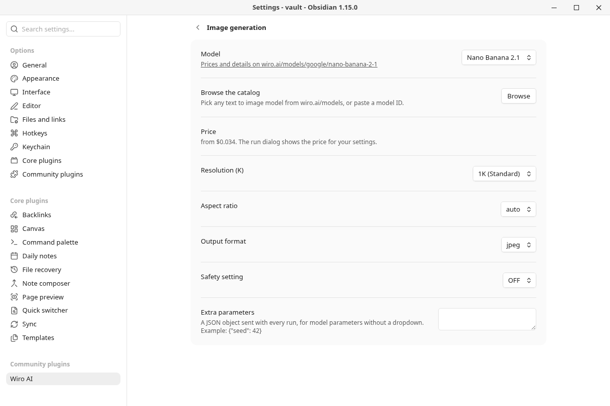

## Settings

| Setting | What it does |
| --- | --- |
| **API key**, **API secret** | Links the key, and the secret for signature-based projects, from Obsidian's keychain |
| **Check the key** | Sends one free request to see if Wiro AI accepts the key |
| **Model** | The model for each kind: image generation, image editing, upscaling, video, speech, music, transcription and text |
| **Browse the catalog** | Picks any model of that kind from the catalog, or takes a pasted model ID |
| Model options | One dropdown per option of the chosen model, such as **Aspect ratio**, **Resolution**, **Duration** or **Voice**. The dialogs show the main ones too and remember your choice |
| **Extra parameters** | A JSON object sent with every run of that kind, for parameters without a dropdown, such as `{"seed": 42}` |
| **Read Markdown as plain text** | For speech: reads link text instead of URLs and skips formatting marks, embeds and code. On by default |
| **Transcript style** | Callout, quote or plain paragraph |
| **Translate into** | The language listed first when you translate |
| **Image folder**, **Video folder**, **Audio folder** | Where new files go. Empty means the attachment folder from **Settings → Files and links** |
| **Show the price before running** | Commands that work on the selection, the whole note or an embed open the dialog with the price first. Turn it off to run them right away. On by default |
| **Editor menu** | Shows the Wiro AI items when you right-click selected text. On by default |

Files are named like Obsidian's pasted images, such as `Wiro image 20261111153012.png` or `Wiro speech 20261111153012.mp3`, and the embed follows your link format (wikilinks or Markdown links).

## Network use and privacy

Running a model needs a Wiro AI account and an API key, and each run is charged to that account (see [Pricing](#pricing)). The plugin talks to Wiro AI only, and only when you run a command, open the history panel or open its settings:

- **`api.wiro.ai`**, with your API key (and a signature for signature-based projects):
  - A run sends the text of the command, such as the prompt, the selection or the note for **Read note aloud**, with the model options, to the [Run API](https://wiro.ai/docs/run-a-model), then reads the task status until it ends ([Tasks](https://wiro.ai/docs/tasks)). **Cancel** stops the task.
  - **Edit image**, **Upscale image**, **Transcribe audio** and the file fields of **Run a model** and **Run a workflow** upload the vault file you chose to Wiro AI's file storage, so the model can read it ([Files](https://wiro.ai/docs/files)).
  - **Run a workflow** lists your project's workflows, reads the inputs of the one you pick, starts it and reads its progress ([Workflows](https://wiro.ai/docs/workflows)).
  - **Check** and the history panel read the list of your recent tasks.
- **`api.wiro.ai`**, without your key: the model catalog, the inputs and options of a model and its price come from the public catalog when you browse it, when a dialog opens or a run starts (once per model and session), and when the settings show a model that is not in the built-in list.
- **`llm.wiro.ai`**: the writing commands send the selected text, the note (up to 120,000 characters), your question with the note, or for **Continue writing** the last 6,000 characters before the cursor, to the [LLM gateway](https://wiro.ai/docs/completions-api) with your API key. The list of gateway models and their prices loads without your key.
- **`cdn1.wiro.ai`**: the result files are downloaded from Wiro AI's file host and saved in your vault. The plugin downloads files from `wiro.ai` hosts only.

Only what a command needs is sent: the text above and the files you choose. The rest of the vault stays on your device. The plugin has no telemetry or analytics and makes no requests in the background. See Wiro AI's [privacy policy](https://wiro.ai/agreement/privacy-policy) and [terms of service](https://wiro.ai/agreement/terms-of-service).

## How it works

- Requests go through Obsidian's `requestUrl`, which works on desktop and mobile. On desktop, the writing commands read the answer as a stream through Node's `https` module, so the text appears as it is written; the module is loaded only on desktop and only connects to `llm.wiro.ai`.
- A run is a `POST /Run/{owner}/{model}` request. The plugin polls `Task/Detail` every few seconds until the task reaches `task_postprocess_end`, checks that `pexit` is `"0"` and saves the output files.
- Required inputs you don't set get the defaults from the model's page, so a text-to-image or text-to-speech model needs only the prompt. Prices are worked out from the model's price table in the catalog and the options you set.
- A model run gives up after 15 minutes and stops the task. A workflow is checked every few seconds for up to 45 minutes; **Cancel** stops waiting, and the run keeps its results in your Wiro AI dashboard.
- The key is read from Obsidian's keychain at run time and is never written to the vault. The plugin ships as one bundled `main.js` and loads no code from the network.

## Development

```bash
npm install
npm run dev     # rebuilds main.js on every change
npm run lint    # ESLint with eslint-plugin-obsidianmd, the rules Obsidian's plugin review runs
npm test        # unit tests, no network
npm run build   # type check and production build
```

To try a build, copy `main.js`, `manifest.json` and `styles.css` into `<vault>/.obsidian/plugins/wiro-ai/` and reload Obsidian. `npm run models` refreshes the built-in model lists, options and prices in `src/models.json` from the public Wiro AI catalog.

Releases come from tags: `npm version 1.1.1` updates `manifest.json` and `versions.json`, and pushing the `1.1.1` tag runs the release workflow, which builds the plugin, attests `main.js`, `manifest.json` and `styles.css`, and drafts a GitHub release with them. See [CONTRIBUTING.md](./CONTRIBUTING.md).

## Pricing

Each run is charged to your Wiro AI account at the model's price, listed on its model page. A few of the defaults: Nano Banana 2.1 costs $0.0336 per image at 1K, Seedance 1 Pro Fast $0.05 for a 5-second 480p video, Eleven v4 $0.08 per 1,000 characters, ElevenLabs Speech to Text $0.006 per minute of audio, and Gemini 3 Flash $0.50 per million input tokens and $3.00 per million output tokens. The dialogs show the price before a run, the notice at the end shows what it cost, and [wiro.ai/panel](https://wiro.ai/panel) has your balance and usage.

## More from Wiro AI

| Repository | What it is |
| --- | --- |
| [Wiro-MCP](https://github.com/wiroai/Wiro-MCP) | Official MCP server for Wiro AI, [`@wiro-ai/wiro-mcp` on npm](https://www.npmjs.com/package/@wiro-ai/wiro-mcp) |
| [Wiro-Plugin](https://github.com/wiroai/Wiro-Plugin) | Wiro AI plugin for Cursor, Claude Code, Gemini CLI and Devin |
| [Wiro-LLM](https://github.com/wiroai/Wiro-LLM) | Wiro AI provider for the Vercel AI SDK and LLM gateway examples, [`@wiro-ai/wiro-llm` on npm](https://www.npmjs.com/package/@wiro-ai/wiro-llm) |
| [Wiro-Obsidian](https://github.com/wiroai/Wiro-Obsidian) | Wiro AI plugin for Obsidian (this repository) |
| [Wiro-ComfyUI](https://github.com/wiroai/Wiro-ComfyUI) | Wiro AI nodes for ComfyUI |
| [Wiro-Dify-Plugin](https://github.com/wiroai/Wiro-Dify-Plugin) | Wiro AI plugins for Dify: the LLM gateway as a model provider, plus image, video, speech and music tools |
| [Wiro-Raycast](https://github.com/wiroai/Wiro-Raycast) | Wiro AI extension for Raycast |
| [Wiro-WordPress](https://github.com/wiroai/Wiro-WordPress) | Wiro AI plugin for WordPress |
| [Wiro-Blender](https://github.com/wiroai/Wiro-Blender) | Wiro AI add-on for Blender |
| [Wiro-Figma](https://github.com/wiroai/Wiro-Figma) | Wiro AI plugin for Figma |
| [Wiro-Next-Starter](https://github.com/wiroai/Wiro-Next-Starter) | Next.js starter for Wiro AI |
| [Wiro-Zed](https://github.com/wiroai/Wiro-Zed) | Wiro AI MCP server for the Zed editor |
| [Wiro-Action](https://github.com/wiroai/Wiro-Action) | GitHub Action for Wiro AI |
| [Wiro-Hermes](https://github.com/wiroai/Wiro-Hermes) | Wiro AI as a model provider for Hermes Agent |
| [n8n-nodes-wiroai](https://github.com/wiroai/n8n-nodes-wiroai) | Wiro AI nodes for n8n, [`@wiro-ai/n8n-nodes-wiroai` on npm](https://www.npmjs.com/package/@wiro-ai/n8n-nodes-wiroai) |
| [Wiro-Chromium-Extension](https://github.com/wiroai/Wiro-Chromium-Extension) | Wiro AI extension for Chrome, Edge, Opera and Brave |
| [Wiro-Firefox-Extension](https://github.com/wiroai/Wiro-Firefox-Extension) | Wiro AI add-on for Firefox |
| [Wiro-Safari-Extension](https://github.com/wiroai/Wiro-Safari-Extension) | Wiro AI extension for Safari on the Mac |
| [Swift-QuickStart](https://github.com/wiroai/Swift-QuickStart) | WiroKit, the Wiro AI SDK for iOS |
| [Kotlin-QuickStart](https://github.com/wiroai/Kotlin-QuickStart) | WiroKit, the Wiro AI SDK for Android |
| [Dart-QuickStart](https://github.com/wiroai/Dart-QuickStart) | Wiro AI SDK for Dart and Flutter, [`wiro` on pub.dev](https://pub.dev/packages/wiro) |
| [ReactNative-QuickStart](https://github.com/wiroai/ReactNative-QuickStart) | Wiro AI SDK for React Native and Expo, [`@wiro-ai/wiro-react-native` on npm](https://www.npmjs.com/package/@wiro-ai/wiro-react-native) |
| [Swift-Realtime](https://github.com/wiroai/Swift-Realtime) | Realtime voice AI example for iOS |
| [Kotlin-Realtime](https://github.com/wiroai/Kotlin-Realtime) | Realtime voice AI example for Android |
| [Dart-Realtime](https://github.com/wiroai/Dart-Realtime) | Realtime voice AI example for Flutter |
| [ReactNative-Realtime](https://github.com/wiroai/ReactNative-Realtime) | Realtime voice AI example for React Native |
| [Wiro-Docs](https://github.com/wiroai/Wiro-Docs) | Source of the Wiro AI API docs |

[Website](https://wiro.ai) · [Models](https://wiro.ai/models) · [Docs](https://wiro.ai/docs) · [X](https://x.com/wiroai)

## License

MIT, see [LICENSE](./LICENSE).
